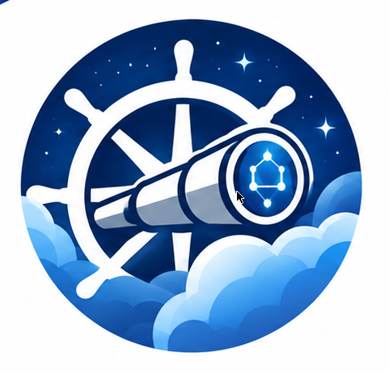
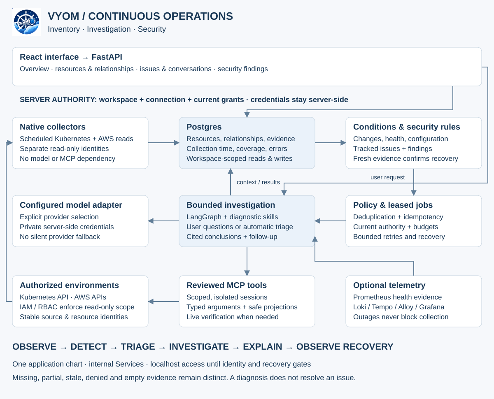

  

<h1 align="center">Vyom</h1>

AWS + Kubernetes Operations Toolkit

**Vyom helps engineers understand what is running, what is unhealthy, and what is risky across Kubernetes and AWS.**

Designed for DevOps engineers, SREs, cloud engineers and platform engineers, Vyom brings infrastructure inventory, operational investigation and configuration security into one read-only operations station. Vyom continuously watches authorized environments for meaningful changes, failures and security signals, then brings the evidence into focused investigations.

## Continuous operations

Follow the operational loop from discovery to recovery: **observe → detect → triage → investigate → explain**.

An operations overview brings together active issues, recent changes, inventory freshness and investigation progress. Related observations update a tracked issue with affected resources, evidence and a timeline. Deterministic conditions trigger bounded agent investigations; fresh recovery evidence updates the issue when the problem clears.

Open an issue and continue in natural language: “What changed before this started?”, “Which workloads are affected?” or “What evidence would confirm that?” Automatic triage and user-led investigation share the same evidence and permission boundaries.

## Inventory

Understand what exists, where it runs and how it connects. Search and filter resources by provider, account, region, cluster, namespace, type, status, tags and labels. Resource details bring together metadata, health, relationships, findings and supporting evidence.

Follow relationships from a Deployment to its Pods and Nodes, or from an EC2 instance through its network interfaces, subnets and security groups. Cross-platform relationships connect Kubernetes workloads to the AWS infrastructure beneath them.

## Investigation

Investigate unhealthy workloads and infrastructure failures through guided diagnostic workflows. Ask why a Pod is pending, why a workload is not ready, or why one server cannot reach another on a specific port.

Stored inventory provides context. Selective live queries verify missing or stale facts. Each investigation presents its steps, evidence, hypotheses, conclusion, confidence and suggested next diagnostic actions. Configuration evidence and observed traffic remain distinct, and incomplete evidence stays visible.

## Security

Detect configuration risks through deterministic rules and investigate source-attributed security signals. Configuration findings remain distinct from confirmed incidents. Findings identify affected resources, explain why a rule triggered, cite evidence and suggest remediation. Categories distinguish security issues from reliability, operational and configuration concerns.

Framework mappings provide context from Kubernetes Pod Security Standards, CIS benchmarks, the AWS Well-Architected Security Pillar and internal policies. AI explains and contextualizes findings; it does not invent them or certify compliance.

## Ask Vyom

- What is running in namespace payments?
- What is wrong with checkout?
- Why is this Pod pending?
- Why can't app-a reach db-b on TCP/5432?
- Which workloads are privileged?
- Which security groups expose SSH publicly?
- Show resources related to this load balancer.

Conversation stays focused on inventory, investigation and security.

## How it works

Continuous-operations workflow

[Scalable workflow diagram](docs/diagrams/readme-architecture.svg).

A React interface connects to FastAPI and three shared product domains:

- **Inventory collectors** use native Kubernetes and AWS APIs to maintain normalized resources and relationships in Postgres.
- **Investigation workflows** combine existing inventory with bounded agent tools and explicit diagnostic skills. MCP provides an integration boundary for agent-driven queries.
- **Security rules** evaluate inventory deterministically and attach evidence to findings.

Collection policies control freshness. Evidence records source identity, resource identity, observation time, coverage and limitations. External metrics, events and logs supply diagnostic evidence without making Vyom an observability backend. AI-generated text is explanation, never infrastructure evidence.

## Read-only by design

The server enforces tenant, account, cluster, namespace and tool permissions. Prompts and browser filters cannot grant access. Credentials remain server-side, sensitive values are excluded from evidence, and tool execution is bounded. Infrastructure mutations and autonomous remediation are outside the product boundary.

Vyom focuses on AWS and Kubernetes operations. Cost optimization, general-purpose chat, deployment orchestration, SIEM and compliance certification are outside that boundary.

## Project documentation

- [Architecture](docs/ARCHITECTURE.md)
- [Continuous operations](docs/CONTINUOUS_OPERATIONS.md)
- [Product scope](vyom-12-week-sprint-plan.md)
- [Local development and deployment](docs/LOCAL_DEVELOPMENT.md)
- [Design system](docs/design/DESIGN.md)
- [Branding](docs/BRANDING.md)
- [Contributor agreement](AGENTS.md)
