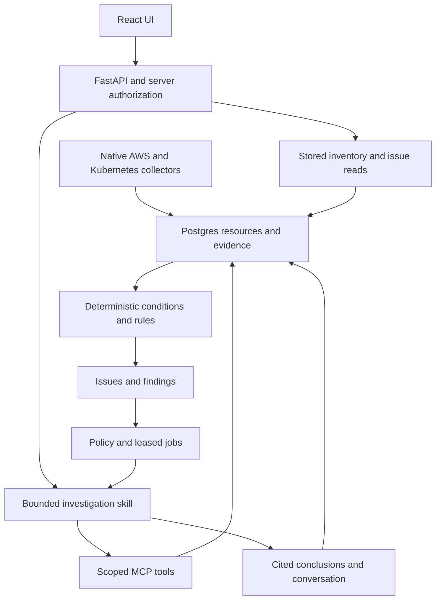

# Vyom architecture

Design target: a continuous AWS + Kubernetes operations station with Inventory, Investigation and Security. [Tracker](TRACKER.md) records implementation status; this document defines boundaries, not deployed capability.

## Components and paths

React/Refine/shadcn UI calls one FastAPI application. Native collectors maintain normalized resources, relationships, collection runs and evidence in Postgres. Read APIs serve stored state; browsing does not initiate an environment-wide provider scan. Configurable scheduling is independent of the UI and model.

Deterministic change/health/security rules evaluate authorized observations and create findings or issue episodes. A scoped trigger policy schedules bounded investigation jobs. Postgres leases and idempotent attachment support crash recovery; no broker is required. The same investigation skill serves user questions and automatic triage. Inventory supplies context, authorized tools verify missing/stale facts, and conclusions cite stored evidence.

## Domain boundaries

Resource identity includes workspace, authorized connection and native incarnation identity; names are lookup aliases, not durable identity. Relationships are scoped rows with source/target, type, verification time and evidence. Retain observations separately from latest state. Collection coverage governs reconciliation: failed/partial scans cannot mark absent resources or resolve issues.

Issue state is independent from investigation state. Model/tool failures leave deterministic evidence visible. Fresh recovery evidence or explicit operator disposition closes an episode; model conclusions cannot. See [continuous operations](CONTINUOUS_OPERATIONS.md) for exact lifecycle and race handling.

Security findings are deterministic, versioned rule results. Preserve category, policy parameters, evidence, remediation and framework metadata. External detections retain source confidence and are not automatically confirmed incidents. No SIEM or telemetry backend is part of this architecture.

## Integration and authorization

MCP is the agent-facing boundary, not inventory transport. Reuse pinned upstream Kubernetes MCP and suitable AWS-provided integrations; no custom general MCP server. Direct collectors use separate provider identities. Host validation and provider RBAC/IAM both enforce scope, argument/result projections and budgets. Scoped sessions, current grants and credential isolation apply to background jobs and historical data as well as live requests.

Postgres and internal libraries use normal clients. The initial model is explicitly configured behind the existing adapter; switching providers is a tested separate change. Document RAG/vector storage is deferred. Prometheus can supply health evidence; Grafana/Loki/Tempo/Alloy are optional operational tooling.

## Deployment and failure behavior

One application chart on Kind packages the API/UI and pinned upstream MCP with private auth. Add Postgres and a small worker using the application image when their consuming tasks land. Keep Services internal and access localhost-only until the identity/recovery gate. [Local setup](LOCAL_DEVELOPMENT.md) describes actual profiles and implementation limits.

Inventory remains usable when model/MCP services fail. Stale observations are explicit when collection fails. Durable jobs use bounded retries/leases; lost telemetry must never block requests. Credential values, provider payloads, questions and answers never enter routine logs or metrics. [Verification](VERIFICATION.md) defines evidence requirements.

The [diagram index](diagrams/README.md) links the current README architecture image and historical interactive references. Old RAG/cost/sprint layouts do not govern this design.

## Deployment mappings

The [deployment diagram](diagrams/deployment/deployment.png) and [interactive view](diagrams/deployment/deployment.html) describe the target hosting topology. The README workflow is a separate view. Namespace boundaries denote placement, not proof of network isolation. This diagram introduces no ingress, cloud provisioning or extra microservice framework.

The existing chart defines UI/API/MCP Deployments, Services and a token-refresher CronJob. Postgres and the background worker are architecture targets from R2–R4a, not existing manifests. Their exact workload names, database packaging/port, PVC sizing and backup destination are deliberately unspecified until implementation. The worker shares the application image; no HTTP Service is required for polling leased jobs. Worker credential mounts and provider sessions must be scoped independently when introduced.

| Caller / owner | Destination | Protocol / mapping | Authority and purpose |
|---|---|---|---|
| Operator browser | `vyom-ui.vyom.svc:8080` | Localhost port-forward → HTTP | No public ingress; remote access gated by R10 |
| UI NGINX | `vyom-api.vyom.svc:8000` | `/api/` reverse proxy → HTTP | API supplies trusted workspace and grants |
| API / background worker | Postgres | Database client / scoped SQL | Resources, evidence, relationships, issues, conversation and leased jobs; Postgres is not an MCP tool |
| API / investigation worker | `kubernetes-mcp.vyom.svc:8443` | TLS / MCP with audience-bound token | Host allowlist/budgets and proxy TokenReview + SubjectAccessReview |
| MCP proxy container | MCP server container in the same Pod | HTTP `127.0.0.1:8080` | Only proxy port exposed through Service |
| MCP server | Authorized Kubernetes API | HTTPS; upstream read-only tools | MCP ServiceAccount, independent of collector identity |
| Native collection worker | Kubernetes / AWS APIs | Native API clients / HTTPS | Collector grants; no MCP/model dependency |
| API / investigation worker | Configured model endpoint | HTTPS via existing model adapter | Explicit provider and server-side credential; no silent fallback |
| Token-refresh CronJob | Hosting Kubernetes API / collector Secret | TokenRequest + narrowly scoped Secret patch | Refresher identity cannot use the MCP endpoint or read workload data |
| Kubernetes volume projection | API, MCP and worker consumers | Read-only Secret/ConfigMap/projected-token mounts | Model/provider credentials never reach the UI; worker mounts are target design |
| Prometheus | API `/metrics`, kube-state-metrics, node exporter | HTTP scrape, selected by ServiceMonitors | Optional metrics profile; observer identity |
| Prometheus Operator | Prometheus resources and monitors | Kubernetes reconciliation | Operator Deployment; not an investigation agent |
| Alloy | Node-local logs | Read-only node mount + allowlisted discovery | DaemonSet; observer access does not authorize agent queries |
| API instrumentation | Alloy | OTLP/HTTP `:4318` (receiver also supports `:4317`) | Full profile only; bounded, sanitized export |
| Alloy | Loki / Tempo | Log push / OTLP traces | Separate stores and PVCs; no request dependency |
| Grafana | Prometheus / Loki / Tempo | Datasource queries | Separate optional UI, accessed privately |

The observability box groups independent workloads for readability: Prometheus Operator Deployment, Prometheus StatefulSet and PVC, kube-state-metrics Deployment, node-exporter DaemonSet, Alloy DaemonSet, Loki and Tempo stores with their PVCs, and Grafana Deployment. See the [profile and chart mapping](OBSERVABILITY.md) for exact packaging. AWS-specific MCP integration placement remains connection/skill-specific; the design does not assume a universal AWS MCP service or custom wrapper. Authentication-provider placement and a remote ingress topology remain unspecified until R10.

Evidence for the interactive view is pinned to repository revision `7a1c8a4873ba78d0b46a969a2c95cf035d25bda4`; sources distinguish chart facts from architecture intent. Current uncommitted diagram/documentation updates do not imply deployed capability. See [session 2026-10-29-07](sessions/2026-10-29-07.md) for artifact verification.
