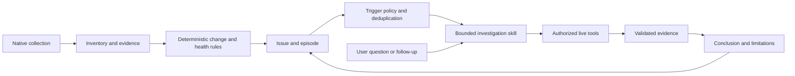

# Continuous operations

Accepted product direction, 29 October 2026. This extends the three-pillar rescope; it is a design and acceptance contract, not a statement of implemented capability.

Vyom continuously observes authorized AWS and Kubernetes environments, detects meaningful inventory changes, failures and security signals, and triages issues through bounded read-only investigations. Natural-language interaction remains available both for ad hoc questions and follow-up within an issue.

## Product model

Inventory, Investigation and Security remain the pillars. Continuous observation connects them. An **issue** is the operational object around which related changes, symptoms, findings and investigations are collected.

| Object | Meaning |
|---|---|
| Resource | Normalized, scoped infrastructure identity and latest known state |
| Observation/evidence | Source-backed fact with observation/collection time, coverage and limitations |
| Change | Difference between comparable observations, with before/after evidence |
| Finding | Deterministic rule result, with category, evidence and policy version |
| Issue | Tracked operational problem grouping related evidence and investigation attempts |
| Investigation | Bounded diagnostic attempt, manually or automatically triggered |
| External security signal | Source-attributed detection; not automatically a confirmed incident |

A configuration risk is not proof of compromise. Preserve external signal severity and confidence separately from Vyom's assessment. Only evidence can support an incident claim; an agent's hypothesis is never an incident fact.

## Observation and detection

Operators register approved connections and collection scope; inventory discovers resources inside that scope. Discovery must not enroll another account, cluster or namespace or broaden credentials. Start with the existing operator-configured local cluster, not remote onboarding.

Native API collectors maintain Postgres state on configurable schedules. Compare normalized, allowlisted fields, excluding irrelevant timestamps and resource-version churn. Initial collection establishes a baseline; it does not claim every existing resource was newly created. Existing unhealthy state can still open an issue. Record collection and rule versions so changes remain reproducible.

Only successful authoritative coverage supports removal detection. Partial reads, permission loss, unreachable providers and expired evidence produce explicit collection/freshness conditions, never mass deletion or recovery. Namespace-scoped collections cannot infer cluster-wide absence. Native UID recreation is a new resource identity; it must not inherit the previous object's edges or issue history implicitly.

Use deterministic conditions, configurable persistence windows and recovery windows to suppress transient noise. Correlation begins with exact resource/owner relationships and explicit detector rules; avoid speculative LLM clustering. A change preceding a failure is temporal evidence, not proof of causation.

## Issue lifecycle

Issue state and investigation state are independent. Issue state is `open`, `acknowledged` or `resolved`. Acknowledgement records operator attention; it does not stop evidence collection or claim health. Suppression is an explicit scoped policy with reason and expiry, not a recovered state.

- First qualifying condition opens an issue with first/last observed times and evidence.
- Repeated matching observations update that issue rather than opening another.
- Fresh matching observations update last_seen; collector failure does not.
- Fresh authoritative recovery evidence across the configured recovery window resolves it.
- Resource disappearance alone does not prove recovery. Verified deletion may close an issue with an explicit `resource_removed` reason; replacement has a different UID.
- Recurrence reopens the issue as a new episode for the same resource/detector, preserving earlier evidence and attempts. A running investigation from an older episode cannot overwrite the new episode's assessment.

An initial fingerprint contains workspace, authorized connection, stable resource identity, detector ID and condition key. Enforce uniqueness for the active episode in Postgres. Scope every relationship, issue, evidence reference, query and job. Record detector/policy version with occurrences; rule-version changes require explicit reconciliation rather than accidental duplicate issues.

## Agent triage

The same skill supports user-triggered and automatic investigations. A trigger binds an issue episode, current evidence revision, scope and skill. The model does not choose its own authority. Before execution and each live call, revalidate the connection and applicable grants, including for historical evidence and follow-up conversation.

Automatic triage is enabled through explicit operator policy for allowlisted conditions/skills. Enforce workspace/connection concurrency limits, deduplication, cooldowns, call/token/time/output limits and retry caps. New evidence can justify a new attempt; identical polls cannot. Persist job state in Postgres using leases and idempotency keys; no new broker or multi-agent infrastructure is required. Expired leases permit bounded retry after crashes without losing the issue. Treat execution as at-least-once and make result attachment idempotent.

Investigation outcomes include queued, running, completed, insufficient_evidence, unavailable and cancelled. Model/tool failure leaves the issue and deterministic evidence visible. A diagnosis does not resolve an issue; only recovery evidence or a recorded human disposition can do that. Manual resolution records a reason and must remain distinguishable from observed recovery; a persistent qualifying condition may reopen it.

Natural-language follow-ups reference the issue, episode and cited evidence. Explicitly disclose stale observations and new live reads. Keep conversation and model output separate from evidence; never store them in routine telemetry. Conversation retention is scoped and bounded, with no generic agent memory requirement.

## UI and persistence

Overview becomes an operations desk: active issues, meaningful changes, inventory freshness and investigation progress. Issue detail holds the timeline, resources, evidence, findings, attempts, conclusion and follow-up conversation. Inventory and Security retain dedicated views. Add these surfaces only as their APIs become real; no placeholder dashboards.

R2 still starts with resources, relationships, collection_runs and evidence. Preserve observation history needed for safe comparisons, but do not create unused issue/job tables in advance. Add changes, issues/episodes, issue evidence links and investigation job/step persistence with the first monitoring loop. Use workspace-scoped foreign keys and uniqueness constraints, bounded retention and restart-safe reconciliation. Do not introduce Neo4j, Kafka, a vector store or separate observability backend.

External metrics, logs and security detections are evidence providers. Prometheus is useful for health; Loki/Tempo/Grafana are optional. This product does not collect arbitrary telemetry, implement SIEM ingestion, remediate infrastructure or create paid analysis jobs without specific authorization.

## First acceptance loop

After inventory and the manual workload skill are verified, deliver one local Kind loop:

1. Establish a healthy Deployment baseline and its ReplicaSet/Pod relationships.
2. The lab operator applies a known broken rollout; Vyom itself performs no infrastructure mutation.
3. Collection records the configuration change and unhealthy state with source/time/coverage.
4. A deterministic condition opens exactly one issue and enqueues one allowed workload investigation.
5. The skill gathers bounded evidence and explains the likely cause with resolving citations.
6. The user asks what changed and which evidence supports the diagnosis; answers remain scoped to authorized facts.
7. The operator fixes the lab; fresh recovery observations resolve the episode while retaining its history.

Repeat polls and job retries must not create duplicate issues or conclusions. Verify flapping, provider outage, model outage, partial collection, worker restart, UID recreation, stale evidence, recovery during investigation and scope revocation. Record trigger-to-detection and queue/run durations against configured policies; do not invent a universal detection SLA. Unavailable telemetry or model services must not block inventory or deterministic issue updates.

AWS expansion still waits for the ten Kubernetes diagnostic cases and this first automatic loop. Kubernetes posture can attach deterministic findings to the same issue model after its own evidence gate. AWS inventory/connectivity then reuse the model; broader external security integrations arrive one evidence source at a time.
