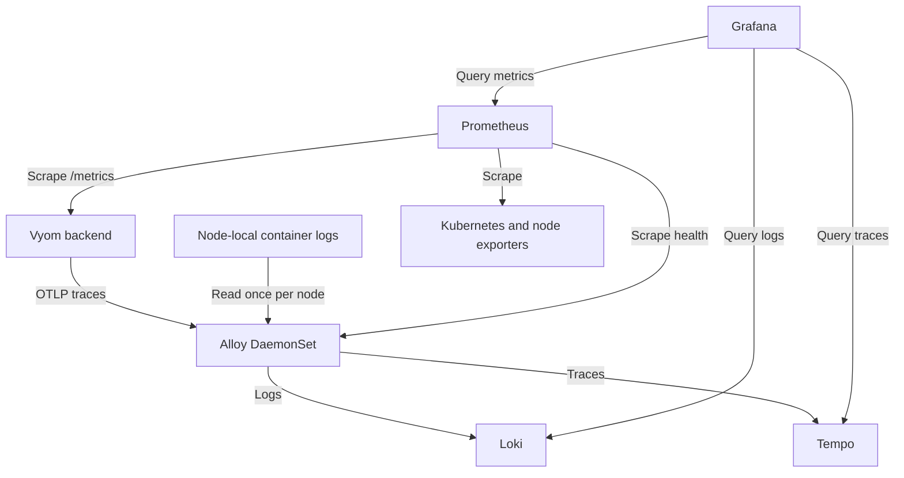

# Observability from S1

Owner requirement, 2026-10-04: Loki, Prometheus, Grafana and OpenTelemetry-based tracing belong in the first working project. The stack and the backend telemetry baseline were installed and checked on Kind in S1.9 ([what is installed](#installed-on-kind-in-s19)); a correlated trace of a real chat is still undelivered and closes in S1.8. Sections below the installed summary remain the design. The [constitution](../vyom-12-week-sprint-plan.md) governs scope; [implementation tasks](IMPLEMENTATION_PLAN.md) carry budgets and gates.

## Initial stack

| Component | Responsibility | Initial deployment |
|---|---|---|
| Prometheus | Cluster/app metrics, request/tool/provider rates, errors and latency | Single instance with PVC; pinned kube-prometheus-stack includes operator, kube-state-metrics and node exporter |
| Loki | Sanitized application and allowlisted container logs | Single-binary mode, PVC, short retention |
| Tempo | Store/query OpenTelemetry traces | Monolithic mode, PVC, short retention; verify pinned chart/image compatibility |
| Grafana | Cluster and Vyom dashboards; metric/log/trace exploration | One instance from kube-prometheus-stack; provision data sources/dashboards as code |
| Grafana Alloy | Node-local logs and OTLP trace reception/processing/export | DaemonSet, internal OTLP Service, bounded buffers and read-only log mounts |
| OTel SDK | Request, graph-step, model-client, MCP-client and collector spans | Inside the existing backend |

Alloy supports native OpenTelemetry pipelines and OTLP reception, so it fills the collector role. Prometheus owns metric scraping; Alloy owns logs and trace forwarding. Do not collect the same stdout stream through a second OTLP log pipeline. Use `vyom` and `observability` namespaces, one application chart and pinned vendor releases in a single reproducible Kind/EKS workflow. Disable unused chart components; avoid a second Grafana or a distributed stack in S1.

## Installed on Kind in S1.9

`scripts/observability-up.sh` installs four pinned charts into `observability` from [charts.lock](../deploy/observability/charts.lock), each with a values file beside it; `scripts/observability-check.sh` verifies the result through localhost port-forwards.

| Release | Chart | Application | Notes |
|---|---|---|---|
| kube-prometheus-stack | prometheus-community 92.3.0 | Operator v0.94.1, Prometheus v3.15.0, Grafana 13.2.3, kube-state-metrics v2.20.0, node exporter v1.12.1 | Alertmanager, default rules and default dashboards off. etcd, scheduler, controller-manager, kube-proxy and API server scrapes off |
| loki | grafana-community 18.15.1 | Loki 3.7.8 | Monolithic, filesystem on a PVC, gateway/caches/canary off |
| tempo | grafana-community 3.1.0 | Tempo 3.1.0 | Single binary, local storage on a PVC, no Kafka |
| alloy | grafana 1.13.1 | Alloy v1.20.1 | DaemonSet; pipeline in [config.alloy](../deploy/observability/config.alloy) |

- **Chart sources changed.** `grafana/loki` is now maintained for Enterprise Logs only and `grafana/tempo` is marked deprecated; both moved to `grafana-community/helm-charts`. Alloy is still published under `grafana`.
- **Bounds.** Retention is 48 hours in all three stores. Prometheus also has a 3 GB size cap. Loki has ingestion-rate, line-size, label-count and stream limits; Tempo has ingestion limits. Every workload has a memory limit. PVCs request 4 Gi each, but Kind's local-path provisioner does not enforce PVC size, so on Kind the time and rate limits are the real bounds.
- **Logs.** Alloy discovers pods on its own node in `vyom` and `observability` only and reads their files from a read-only `/var/log` mount. Indexed labels are `namespace`, `service_name`, `container` and `stream`; the pod name is structured metadata. A redaction stage replaces values after `authorization`, `api_key`, `password`, `token` and `secret` keys. Read positions persist on the node at `/var/lib/vyom-alloy`.
- **Traces.** Alloy receives OTLP on 4317/4318, applies a memory limiter, deletes header, URL-query and prompt/completion attributes, batches, and exports to Tempo with a 200-batch queue and a one-minute retry budget; after that spans are dropped and counted in `otelcol_exporter_send_failed_spans_total`.
- **Observer identity.** The `alloy` ServiceAccount has a namespaced Role in `vyom` and `observability` allowing `get/list/watch` on pods, and no ClusterRole.
- **Grafana.** ClusterIP only; the admin password is generated into the ignored `.local/grafana-admin-password` and injected as the `grafana-admin` Secret. Data sources (Prometheus, Loki, Tempo) and both dashboards are provisioned as code, with log-to-trace and trace-to-log links by trace ID.
- **Backend baseline** in `backend/src/vyom/telemetry.py`: JSON logs restricted to an allowlist of fields with `trace_id`/`span_id`; `vyom_http_requests_total` and `vyom_http_request_duration_seconds` labelled by route template; `/metrics`; request spans exported over OTLP/HTTP when `OTEL_EXPORTER_OTLP_ENDPOINT` is set, through an exporter wrapper that strips URL queries, headers and exception text, with a 512-span queue.
- **MCP client (S1.2)**: `vyom_mcp_client_operations_total` and `vyom_mcp_client_operation_duration_seconds` labelled by configured server, configured tool, operation and outcome; spans `mcp.client.discover`, `mcp.client.call` and `evidence.normalize`; log fields `mcp_server` and `mcp_tool`. Names that are not configured are recorded as `unlisted`. Records from the HTTP and MCP client libraries are dropped. Exercised by fixture tests and by the S1.3 live check in process; nothing is scraped or exported from a deployed backend yet, and there is no dashboard panel.
- **Model client (S1.4)**: `vyom_model_requests_total{provider,model,outcome}`, `vyom_model_request_duration_seconds{provider,model}`, `vyom_model_tokens_total{provider,model,direction}` from provider-reported usage only, and `vyom_model_usage_unavailable_total{provider,model}` for successful replies without a usage report; span `model.client.chat` with provider, model, outcome, tool-call count and reported token counts; one `vyom.model` log line per request with `model_provider`, `model_name` and, when reported, `input_tokens` and `output_tokens`. Provider and model are operator configuration. No message, reply, tool definition, endpoint URL, header or provider error text is recorded; LangSmith export is disabled per request, and records from the `openai`, LangChain and LangSmith loggers are dropped. Exercised by scripted-response tests and, in process, by the live check against the provider; nothing is scraped or exported from a deployed backend yet, and there is no dashboard panel.
- **Upstream MCP pod logs (S1.3)**: collected because the pod runs in `vyom`. At `log_level = 0` they hold session lines, permission-denied notices naming the tool, and proxy authentication failures; checked live for tokens, arguments, pod names and env values ([MCPK05](DECISIONS.md#s13-upstream-kubernetes-mcp-on-kind--2026-10-12)). The server's own metrics and tracing are not enabled or scraped.

Known gaps: Prometheus does not scrape the backend until the Vyom chart deploys it with a ServiceMonitor (S1.7), so the API panels of the second dashboard are empty; graph, model and MCP-client panels arrive with those metrics (S1.2–S1.5); the pinned Tempo chart cannot render without its Jaeger receivers, which stay open on the internal Service; no chat trace or log-to-trace navigation in the Grafana UI has been demonstrated.

## Collection topology

Arrows represent collection/export or query initiation, not application request dependencies.

Filter log discovery to each collector's node and allowlisted namespaces/workloads. Verify upstream MCP debug/payload logging is disabled before collecting its logs. Log mounts and discovery permissions give an infrastructure observer access: use a separate, minimally privileged ServiceAccount, never the agent identity. This does not expand MCP tool access.

## First instrumentation and views

Trace HTTP request → owned LangGraph steps → outgoing model/MCP clients → evidence normalization → response using stable span names and W3C context. Verify upstream MCP propagation/internal spans only where supported by the pinned server; external provider internals are not promised. Instrument direct collectors as added.

Use sanitized JSON logs with service, operation, outcome, `trace_id` and `span_id`. Trace/request/session/resource IDs belong in log fields or structured metadata, not metric or Loki indexed labels. Bound metric dimensions to route templates, configured tool/server IDs, provider/model and outcome. Disable prompt/completion/tool-body capture; strip credentials, sensitive headers/URL queries, raw prompts/answers/tool results, literal pod env and unsafe exception text at the source.

Provision two dashboards: cluster CPU/memory/readiness/restarts/availability/scrape health, and Vyom request/graph/model/tool latency/errors plus collector freshness/export health. Provider-reported token usage is useful when available; unavailable is not zero. Provision Loki-to-Tempo and Tempo-to-Loki links by trace ID/service/time. Metrics are aggregate; metric exemplars are optional, not a claim that every sample identifies a request.

The S2 Metrics Server/CloudWatch product views remain separate source paths. CloudWatch-to-Prometheus export and agent queries of the telemetry stores are later scope.

## Progressive delivery

| Sprint | Required increment |
|---|---|
| S1 | Entire stack on Kind; start with 48-hour retention, bounded PVC/resources/buffers and 100% tracing for small demo traffic with volume limits; two dashboards and real correlated chat/failure proof |
| S2 | Same pins on EKS with validated storage/resources; repeat S1 gates, instrument AWS SDK/MCP clients; label inaccessible managed control-plane targets |
| S3 | Instrument Bedrock/embeddings, retrieval, database/vector clients and jobs as added; no raw query/vector/document capture |
| S4 | Investigation/cost-path timings and outcomes; Jev spans if implemented/enabled |
| S5 | Measure sizing, tune sampling/retention, select durable object storage where needed; tested alerts and telemetry recovery |
| S6 | Decide operator-only versus tenant-visible telemetry; enforce current grants on exposed queries/proxies and Grafana access before shared login/exposure |

These are initial sizing choices, not measured results. Pin versions and verify retention/compaction/storage/upgrade support. Current Tempo mode documentation distinguishes Kafka-free monolithic operation from Kafka-dependent microservices operation; verify the selected release instead of adding Kafka from generic deployment examples. PVCs are not backup or HA.

Grafana uses private authenticated localhost port-forward access and privately injected credentials before Keycloak. Stores and OTLP endpoints stay internal; internal Services alone do not provide authentication or tenant isolation. S6 must not equate a tenant label/filter with authorization over shared operator telemetry.

Use bounded asynchronous export/queues/retries so telemetry outage neither blocks chat nor grows memory indefinitely. Record drops and recovery; complete span delivery during outages is not promised. Verify collector failure independently through Prometheus scrape health and Kubernetes status.

## S1 live gate

1. Clean Kind install with recorded pins, private credentials and real cluster metrics/logs; synthetic OTLP smoke spans prove setup only.
2. Real browser question through compatible model, LangGraph and upstream Kubernetes MCP; retain existing evidence/RBAC gates.
3. Inspect applicable request metrics, sanitized logs and the actual owned-component trace in Grafana; record trace ID and demonstrate both log/trace navigation directions.
4. Induce a provider or MCP failure; verify explicit product outcome plus applicable error metrics/logs/span status.
5. Interrupt telemetry separately; prove bounded application behavior, independently observable loss and recovery. Inspect stored signals for prohibited fields and duplicate ingestion.
6. Record exact commands/queries, versions, environment, time window and limits. Repeat on EKS in S2.

## Primary sources checked 2026-10-04

- [Alloy overview](https://grafana.com/docs/alloy/latest/) and [OTel collection](https://grafana.com/docs/alloy/latest/collect/opentelemetry-data/).
- [Alloy Kubernetes logs](https://grafana.com/docs/alloy/latest/collect/logs-in-kubernetes/).
- [Loki monolithic Helm deployment](https://grafana.com/docs/loki/latest/setup/install/helm/install-monolithic/) and [filesystem limitations](https://grafana.com/docs/loki/latest/operations/storage/filesystem/).
- [Tempo deployment modes](https://grafana.com/docs/tempo/latest/set-up-for-tracing/setup-tempo/plan/deployment-modes/) — recheck chart/image mode at implementation.
S1.9 must inspect the selected [kube-prometheus-stack release](https://github.com/prometheus-community/helm-charts/tree/main/charts/kube-prometheus-stack), chart defaults and values directly. GitHub source retrieval was unavailable during this source check; exact release and installed components remain implementation inputs.

Source review is not deployed acceptance. The [interactive overview](diagrams/application.html), [dedicated collection view](diagrams/observability.html) and Mermaid architecture sources reflect this revision; see [diagram verification limits](diagrams/README.md).
