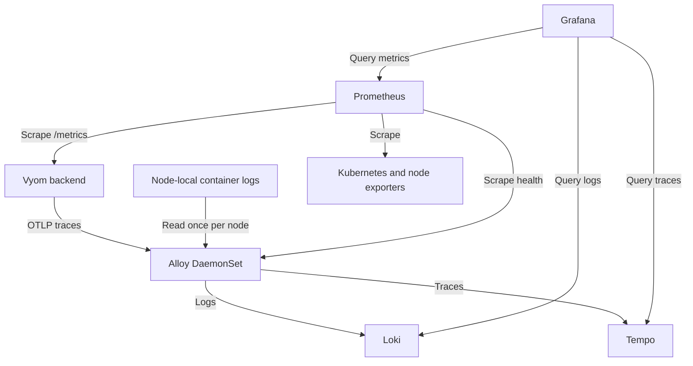

# Observability

Vyom observes infrastructure through existing providers; it does not implement a telemetry storage platform. Prometheus supplies useful health data. Loki, Tempo, Alloy and Grafana are optional operator tooling. Native inventory and deterministic issue state must work without a model or telemetry stores.

## Profiles

See [local development](LOCAL_DEVELOPMENT.md): application defaults to `none`; `metrics` enables ServiceMonitor with a Prometheus installation excluding Grafana; `full` enables the existing log/trace/Grafana stack and OTLP export. Full-stack gates remain optional regression tests. Switching profiles does not erase existing storage or automatically uninstall independent releases.

## Required behavior

Keep logs, metrics and spans payload-free and bounded. No questions, answers, raw tool bodies, literal environment values, sensitive headers/URLs or unsafe exception text. Use fixed metric dimensions, not per-resource/issue IDs. Collection freshness, queue age/depth, lease retries and outcome metrics are added with their owning R task. Unknown usage/loss is not zero. Telemetry outages must not block inventory, investigations or API responses.

Observer credentials do not authorize agent queries. Stores remain private; current grants and two-workspace tests are required before any user-facing telemetry proxy. Retention/PVC capacity is not a backup. [Verification](VERIFICATION.md) governs current acceptance.

## Historical full-stack implementation reference

The S1 labels below refer to previous tests, not mandatory current architecture. Versions are recorded pins, not claims about current upstream releases.

## Installed on Kind in S1.9

`scripts/observability-up.sh` installs four pinned charts into `observability` from [charts.lock](../deploy/observability/charts.lock), each with a values file beside it; `scripts/observability-check.sh` verifies the result through localhost port-forwards.

| Release | Chart | Application | Notes |
|---|---|---|---|
| kube-prometheus-stack | prometheus-community 92.3.0 | Operator v0.94.1, Prometheus v3.15.0, Grafana 13.2.3, kube-state-metrics v2.20.0, node exporter v1.12.1 | Alertmanager, default rules and default dashboards off. etcd, scheduler, controller-manager, kube-proxy and API server scrapes off |
| loki | grafana-community 18.15.1 | Loki 3.7.8 | Monolithic, filesystem on a PVC, gateway/caches/canary off |
| tempo | grafana-community 3.1.0 | Tempo 3.1.0 | Single binary, local storage on a PVC, no Kafka |
| alloy | grafana 1.13.1 | Alloy v1.20.1 | DaemonSet; pipeline in [config.alloy](../deploy/observability/config.alloy) |

- **Chart sources changed.** `grafana/loki` is now maintained for Enterprise Logs only and `grafana/tempo` is marked deprecated; both moved to `grafana-community/helm-charts`. Alloy is still published under `grafana`.
- **Bounds.** Retention is 48 hours in all three stores. Prometheus also has a 3 GB size cap. Loki has ingestion-rate, line-size, label-count and stream limits; Tempo has ingestion limits. Every workload has a memory limit. PVCs request 4 Gi each, but Kind's local-path provisioner does not enforce PVC size, so on Kind the time and rate limits are the real bounds.
- **Logs.** Alloy discovers pods on its own node in `vyom` and `observability` only and reads their files from a read-only `/var/log` mount. Indexed labels are `namespace`, `service_name`, `container` and `stream`; the pod name is structured metadata. A redaction stage replaces values after `authorization`, `api_key`, `password`, `token` and `secret` keys. Read positions persist on the node at `/var/lib/vyom-alloy`.
- **Traces.** Alloy receives OTLP on 4317/4318, applies a memory limiter, deletes header, URL-query and prompt/completion attributes, batches, and exports to Tempo with a 200-batch queue and a one-minute retry budget; after that spans are dropped and counted in `otelcol_exporter_send_failed_spans_total`.
- **Observer identity.** The `alloy` ServiceAccount has a namespaced Role in `vyom` and `observability` allowing `get/list/watch` on pods, and no ClusterRole.
- **Grafana.** ClusterIP only; the admin password is generated into the ignored `.local/grafana-admin-password` and injected as the `grafana-admin` Secret. Data sources (Prometheus, Loki, Tempo) and both dashboards are provisioned as code, with log-to-trace and trace-to-log links by trace ID.
- **Backend baseline** in `backend/src/vyom/telemetry.py`: JSON logs restricted to an allowlist of fields with `trace_id`/`span_id`; `vyom_http_requests_total` and `vyom_http_request_duration_seconds` labelled by route template; `/metrics`; request spans exported over OTLP/HTTP when `OTEL_EXPORTER_OTLP_ENDPOINT` is set, through an exporter wrapper that strips URL queries, headers and exception text, with a 512-span queue.
- **MCP client (S1.2)**: `vyom_mcp_client_operations_total` and `vyom_mcp_client_operation_duration_seconds` labelled by configured server, configured tool, operation and outcome; spans `mcp.client.discover`, `mcp.client.call` and `evidence.normalize`; log fields `mcp_server` and `mcp_tool`. Names that are not configured are recorded as `unlisted`. Records from the HTTP and MCP client libraries are dropped. Exercised by fixture tests and by the S1.3 live check in process; nothing is scraped or exported from a deployed backend yet, and there is no dashboard panel.
- **Model client (S1.4)**: `vyom_model_requests_total{provider,model,outcome}`, `vyom_model_request_duration_seconds{provider,model}`, `vyom_model_tokens_total{provider,model,direction}` from provider-reported usage only, and `vyom_model_usage_unavailable_total{provider,model}` for successful replies without a usage report; span `model.client.chat` with provider, model, outcome, tool-call count and reported token counts; one `vyom.model` log line per request with `model_provider`, `model_name` and, when reported, `input_tokens` and `output_tokens`. Provider and model are operator configuration. No message, reply, tool definition, endpoint URL, header or provider error text is recorded; LangSmith export is disabled per request, and records from the `openai`, LangChain and LangSmith loggers are dropped. Exercised by scripted-response tests and, in process, by the live check against the provider; nothing is scraped or exported from a deployed backend yet, and there is no dashboard panel.
- **Chat graph (S1.5)**: `vyom_chat_requests_total{outcome}` with the graph's eight fixed outcomes, `vyom_chat_duration_seconds`, `vyom_graph_step_duration_seconds{step}` for `propose`, `collect` and `answer`; spans `chat.graph` and `graph.<step>` under the request span, above the model-client and MCP-client spans; one `vyom.chat` log line per question. The response carries the trace ID so a question can be found in Tempo and Loki. Dashboard panels for these are not added yet.
- **Direct collector (S1.6)**: `vyom_collector_runs_total{collector,outcome}`, `vyom_collector_duration_seconds{collector}` and `vyom_collector_last_success_timestamp_seconds{collector}` (freshness; absent until a run succeeds); span `collector.kubernetes.pods`; log field `collector`. Independent of the MCP and model signals. Dashboard panels are not added yet.
- **Upstream MCP pod logs (S1.3)**: collected because the pod runs in `vyom`. At `log_level = 0` they hold session lines, permission-denied notices naming the tool, and proxy authentication failures; checked live for tokens, arguments, pod names and env values ([MCPK05](DECISIONS.md#s13-upstream-kubernetes-mcp-on-kind--2026-10-12)). The server's own metrics and tracing are not enabled or scraped.

Known gaps: since S1.7 the Vyom chart deploys the backend with a ServiceMonitor and Prometheus scrapes it (`up{service="vyom-api"} = 1`, checked by `scripts/vyom-check.sh`); the second dashboard's panels were not looked at in the Grafana UI (the S1.8 gate used the APIs); graph, model and MCP-client panels arrive with those metrics (S1.2–S1.5); the pinned Tempo chart cannot render without its Jaeger receivers, which stay open on the internal Service; no chat trace or log-to-trace navigation in the Grafana UI has been demonstrated.

## S1 live gate results (S1.8)

`scripts/s18-gate.sh` ran against the Kind install on 2026-10-18 and passed; its output is [sessions/evidence/s1-gate-2026-10-18.txt](sessions/evidence/s1-gate-2026-10-18.txt). Versions: the pins in [charts.lock](../deploy/observability/charts.lock) and the images in `vyom-check.sh`'s release.

- A real question through the model, the graph and the upstream MCP server produced Prometheus series (chat, model, MCP, graph-step, HTTP, tokens, collector), exactly five log lines (one `vyom.http`, one `vyom.chat`, two `vyom.model`, one `vyom.mcp`) and one connected 12-span trace in Tempo, with no orphan or duplicate spans.
- Log to trace: the Loki derived field extracts the trace ID and Grafana's Tempo data source returns the trace. Trace to log: Tempo's link target (Loki by trace ID and service) returns the five lines. Both were run through Grafana's API; clicking them in the UI is not recorded.
- A rejected provider key gives `model_unavailable` (HTTP 200, no answer) and an MCP outage gives `no_evidence`; each appears as a chat counter, a model or MCP error counter, a log line and a span outcome, and the direct pods table stays complete during the MCP outage.
- With Alloy stopped the chat is not slowed, the outage shows in `kube_daemonset_status_number_ready`, log lines written meanwhile arrive after recovery, and the spans from the outage are dropped. With Tempo stopped the chat is not slowed, dropped spans are counted in `otelcol_exporter_send_failed_spans_total`, and a new trace is queryable 16 s after Tempo is ready.
- Stored signals (every Loki line in `vyom`, ten traces, every `vyom_` series) hold no question text, key, token, literal environment value, pod name or resource ID, and no duplicates.

Operating notes from the gate: a `kubectl port-forward` to a pod behind a Service dies when that pod is replaced (Tempo, Alloy); Grafana's SQLite can stall for minutes when the host disk is busy, and restarting its pod clears it; the gate takes about 20 minutes.

## Collection topology

Arrows represent collection/export or query initiation, not application request dependencies.

Filter log discovery to each collector's node and allowlisted namespaces/workloads. Verify upstream MCP debug/payload logging is disabled before collecting its logs. Log mounts and discovery permissions give an infrastructure observer access: use a separate, minimally privileged ServiceAccount, never the agent identity. This does not expand MCP tool access.

## First instrumentation and views

Trace HTTP request → owned LangGraph steps → outgoing model/MCP clients → evidence normalization → response using stable span names and W3C context. Verify upstream MCP propagation/internal spans only where supported by the pinned server; external provider internals are not promised. Instrument direct collectors as added.

Use sanitized JSON logs with service, operation, outcome, `trace_id` and `span_id`. Trace/request/session/resource IDs belong in log fields or structured metadata, not metric or Loki indexed labels. Bound metric dimensions to route templates, configured tool/server IDs, provider/model and outcome. Disable prompt/completion/tool-body capture; strip credentials, sensitive headers/URL queries, raw prompts/answers/tool results, literal pod env and unsafe exception text at the source.

Provision two dashboards: cluster CPU/memory/readiness/restarts/availability/scrape health, and Vyom request/graph/model/tool latency/errors plus collector freshness/export health. Provider-reported token usage is useful when available; unavailable is not zero. Provision Loki-to-Tempo and Tempo-to-Loki links by trace ID/service/time. Metrics are aggregate; metric exemplars are optional, not a claim that every sample identifies a request.

Product metrics and authorized investigation queries are separate from internal application telemetry. Add them only with a consuming inventory or skill increment.

## S1 live gate

Historical full-stack regression: `scripts/observability-check.sh` and `scripts/s18-gate.sh` verify metrics, sanitized logs, correlated owned spans, provider/MCP failures and bounded telemetry outages. They require the full profile and model access. Results are recorded in [2026-10-18-02](sessions/2026-10-18-02.md). They do not close the new inventory or issue lifecycle gates.
